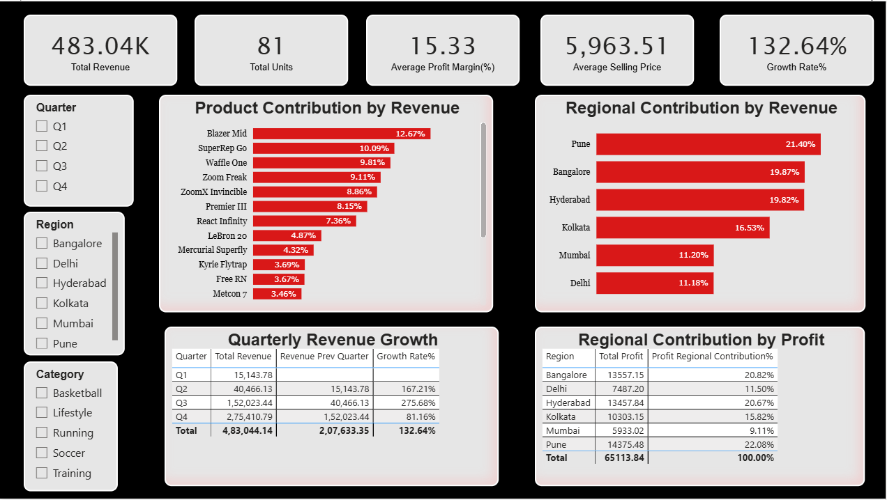

# Nike Sales Analytics: Business Analysis Case Study

A business analyst case study built on a Nike sales dataset (40 orders, January to December 2024). It starts from a business problem and stakeholder needs, defines requirements and KPIs, analyses the data with SQL, builds a Power BI dashboard, and ends with recommendations.

> **Note:** this is a case-study dataset. The findings and recommendations are illustrative and do not represent real Nike business decisions.

**Tools:** Power BI, DAX, Power Query, SQL (SQLite)

---

## Business problem

Nike's management wants to understand sales performance by region and by product, so it can find underperforming segments and decide where to focus revenue effort. The data exists only as order-level records, so managers cannot easily see which regions and products drive revenue, which earn healthy profit, whether regions meet their budgets, or whether revenue is growing from quarter to quarter.

## Approach

1. **Requirements:** defined the problem, objectives, scope and stakeholders (Business Head, Regional Manager, Sales Manager, Marketing Manager, Data/BI team) in a Business Requirements Document.
2. **KPIs and user stories:** defined 8 KPIs with formulas, and wrote 7 user stories with Given/When/Then acceptance criteria.
3. **Data preparation (Power Query):** promoted headers, set data types and removed duplicate orders.
4. **SQL analysis:** wrote 14 queries (SQLite) covering revenue, region and product performance, budget comparison, margin, discounts, seasonality, quarterly growth, ranking and data quality checks.
5. **Dashboard (Power BI):** built a two-page dashboard and checked its numbers against the SQL results.
6. **Recommendations:** turned the findings into actions, with risks and next steps.
7. **Architecture:** documented how data flows from source to business user, and where cloud and AI could fit later.

## Dashboard

**Performance Drivers page, Q4 selected.** Cards for revenue, units, average margin, average selling price and growth; contribution by product and region; quarterly growth; and profit contribution by region.

01-performance-drivers-q4.png

**Performance Drivers page, full year.** Growth Rate% is only meaningful when a single quarter is selected. The full-year value (132.64%) compares the whole year with the first nine months, so it is not a quarter-on-quarter figure.

**Quarterly revenue growth.** Q2 +167.21%, Q3 +275.68%, Q4 +81.16%. Q1 is blank because there is no earlier quarter. The Total row is not a quarterly growth rate.

**Overview page.** Profit margin, total revenue, actual revenue against budget (483.04K against 491.90K, 1.8% below), a date filter, monthly revenue trend, transactions per month, budget distribution by category, and the relationship between budget and profit by product. The MRP visuals show list price (MRP) by region, category and department.

## Key findings

All figures are for 2024 unless stated.

- **Sales are concentrated in Q4.** Q4 brings 57% of revenue (24 of 40 orders). Q1 and Q2 together bring only 11.5%.
- **Pune leads on revenue** (21.4%) and has one of the highest average margins (about 18%).
- **Delhi and Mumbai lag.** Each contributes about 11% of revenue. Delhi's gap is volume, because its margin is healthy. Mumbai also has the lowest average margin (11.6%).
- **Five of six regions finished below budget**, narrowly (1.3% to 3.5%). Only Kolkata beat budget (+0.7%).
- **Discounting shows no revenue benefit.** Orders with no discount average about 14.3K in revenue, against 5.4K for low-discount and 11.1K for high-discount orders.
- **Blazer Mid and SuperRep Go carry the business.** They rank first and second on both revenue and profit. LeBron 20 ranks 8th on revenue but 13th on profit.

See `Business-Recommendations.pdf` for the recommended actions.

## KPI definitions (summary)

| KPI | Definition |
|---|---|
| Total Revenue | Sum of revenue for the selected filters |
| Average Selling Price | Total Revenue ÷ Total Units |
| Profit Margin % | Average of the dataset's Profit Margin(%) column for the selected orders |
| Revenue Growth % (QoQ) | (Revenue − previous quarter revenue) ÷ previous quarter revenue |
| Regional / Product Contribution % | Share of total revenue |
| Regional Profit Contribution % | Region profit ÷ total profit |
| Budget Variance % | (Revenue − Budget) ÷ Budget |

The dataset's margin field is profit as a percentage of cost, so it reads higher than total profit ÷ total revenue (13.48% for 2024). The same definition is used in the dashboard and in the SQL. The full definitions are in the BRD.

## Repository guide

Suggested reading order:

| # | File | What it is |
|---|---|---|
| 1 | `Business-Requirements-Document.pdf` | Problem, objectives, stakeholders, requirements, KPIs, assumptions and expected outcome |
| 2 | `User-Stories.md` | KPI definitions, 7 user stories and acceptance criteria |
| 3 | `SQL-Analysis.sql` | 14 business questions with their SQL queries |
| 4 | `PowerBI-Dashboard.pbix` | The Power BI dashboard (open in Power BI Desktop) |
| 5 | `Business-Recommendations.pdf` | Findings, recommended actions, risks and next steps |
| 6 | `Architecture-Diagram.png` | Data flow from source to business user, with future cloud and AI options |
| 7 | `MoM-Example.md` | An illustrative (fictional) requirements meeting record |
| | `screenshots/` | Dashboard images used in this README |

## Limitations

- **Small sample.** There are only 40 orders. Q1 has 2 orders and most products have 1 to 4, so shares and growth rates are indicative, not conclusive.
- **Margin field.** The dataset's margin column is profit as a percentage of cost, not of revenue.
- **Discount field.** Its unit is not documented (values run from 0 to 1.2), so discount findings use the raw values and show association, not cause.
- **One year of data.** Seasonality cannot be separated from one-off effects.

## Author

Dian Jain | GitHub: [Dian27816](https://github.com/Dian27816)
